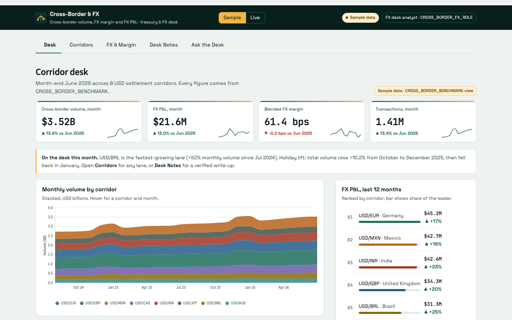

# Cross-Border & FX

**Know which corridors earn their volume, every month-end.** A Snowflake example for the FX and treasury desk of a payments processor: settlement volume, FX margin (bps) and FX P&L by corridor in one app, plus AI desk notes that Cortex `AI_COMPLETE` drafts from a fact pack of allowed numbers and a second `AI_COMPLETE` pass fact-checks before anyone reads them.

The app is branded as **Cross-Border & FX**, for a fictional processor's FX desk. All data is synthetic.

- Guide: https://sfc-gh-jsoliz.github.io/sfguide-cross-border-fx/
- Try it with no account: https://sfc-gh-jsoliz.github.io/sfguide-cross-border-fx/try/

Owner: Javier Soliz · Last reviewed: November 2026

This is an illustrative example, not an official Snowflake product, and not supported by Snowflake Support.



## What it shows

| Screen | What the reader does | Snowflake capability (Live mode) |
|---|---|---|
| **Desk** | Month-end KPIs with year-on-year trends, stacked volume by corridor, ranked 12-month FX P&L, corridor status counts | `CROSS_BORDER_BENCHMARK` view on a dedicated XSMALL warehouse |
| **Corridors** | Search, filter by status and margin, sort any column, open a corridor's detail panel | Same view; status rules computed from it |
| **FX & Margin** | FX paths indexed to July 2024, growth vs margin bubbles, margin heatmap | Same view |
| **Desk Notes** | Pick a scope (all corridors or one), run the grounded note, read the verdict and the verifier's flags; open saved notes | Cortex `AI_COMPLETE` (`claude-sonnet-4-5`) twice: draft, then verify; results in `CROSS_BORDER_REPORTS` |
| **Ask the Desk** | Ask plain-English questions; see the answer, the result table and the SQL | Cortex Agent `CROSS_BORDER_AGENT` with Cortex Analyst over semantic view `CROSS_BORDER_SV`, called with `SNOWFLAKE.CORTEX.DATA_AGENT_RUN` |

Every screen has a **Sample / Live** switch in the top bar and an environment badge. Sample mode runs on the bundled synthetic data; its AI answers were captured from Live runs and are labeled **Sample AI response**, with a 4–8 second staged wait. Live mode never falls back to sample data: a failed query shows the error.

The grounded-note loop is the original pack's design: a fact pack (first and latest month-end per corridor) → a draft under strict DATA RULES → a verifier that returns `status`, `residual_hedges` and `edits` as JSON. On this synthetic data set, 7 of the 9 captured notes came back Verified; the verifier flagged the USD/MXN note for the hedge word "suggesting" and the all-corridors note for a wrong "Brazil led absolute growth" claim.

## Quick start: no account

Python 3.10 or later:

```bash
git clone https://github.com/sfc-gh-jsoliz/sfguide-cross-border-fx.git
cd sfguide-cross-border-fx
python3 -m venv .venv && source .venv/bin/activate
pip install -r app/requirements.txt
streamlit run app/streamlit_app.py
```

The app opens in Sample mode at http://localhost:8501. Or open the hosted example (link above), a dependency-free static copy of the same screens in `docs/try/`.

## Prerequisites (Live mode)

- Snowflake **Enterprise Edition** or higher, in a region where Cortex AI functions (`AI_COMPLETE` with `claude-sonnet-4-5`) and Cortex Agents are available. Change `MODEL` in `app/ai.py` if your region offers a different model.
- A role that can create a role, a warehouse and a database, and grant `SNOWFLAKE.CORTEX_USER` (ACCOUNTADMIN, or USERADMIN plus SYSADMIN-level grants). Everything else runs as the pack's own role.
- For the local Live app: a key pair registered on your Snowflake user.
- Tested November 2026 with Streamlit 1.50.0, snowflake-snowpark-python 1.58, Python 3.12, on AWS US West.

## Live mode

1. Run [`sql/setup.sql`](sql/setup.sql) top to bottom in a Snowsight worksheet. It took **11 seconds** on an XSMALL warehouse in testing.
2. Run the app one of two ways:
   - **Locally, with key-pair auth** (never a password):

     ```bash
     export SNOWFLAKE_ACCOUNT=<orgname-accountname>
     export SNOWFLAKE_USER=<YOUR_USER>
     export SNOWFLAKE_PRIVATE_KEY_PATH=~/.snowflake/keys/<your_key>.p8
     streamlit run app/streamlit_app.py
     ```

     The app connects as `CROSS_BORDER_FX_ROLE` on `SNOWPACK_CROSS_BORDER_FX_WH` (override with `SNOWFLAKE_ROLE` / `SNOWFLAKE_WAREHOUSE`) and opens in Live mode. Credentials stay in your shell; the app never asks for them.
   - **As Streamlit in Snowflake.** Upload the contents of `app/` (keeping `views/`, `sample/`, `static/` and `.streamlit/`) to `@SNOWPACK_CROSS_BORDER_FX.CORE.APP_STAGE/cross_border_fx` in Snowsight, then run as `CROSS_BORDER_FX_ROLE`:

     ```sql
     CREATE OR REPLACE STREAMLIT SNOWPACK_CROSS_BORDER_FX.CORE.CROSS_BORDER_FX
       FROM '@SNOWPACK_CROSS_BORDER_FX.CORE.APP_STAGE/cross_border_fx'
       MAIN_FILE = 'streamlit_app.py'
       QUERY_WAREHOUSE = SNOWPACK_CROSS_BORDER_FX_WH
       TITLE = 'Cross-Border & FX';
     ```

     Inside Snowflake the app uses its own session and opens in Live mode.
3. (Optional) Chat with the agent in Snowsight → AI & ML → Agents → **Cross-Border FX Agent**, or run the [notebook](notebook/lab-cross-border-fx.ipynb) for the same loop step by step.
4. When you're done, run [`sql/cleanup.sql`](sql/cleanup.sql).

## Objects created

| Object | Type | Purpose |
|---|---|---|
| `CROSS_BORDER_FX_ROLE` | Role | Owns every pack object; granted `SNOWFLAKE.CORTEX_USER`, `CREATE DATABASE`, `CREATE WAREHOUSE` |
| `SNOWPACK_CROSS_BORDER_FX_WH` | Warehouse | XSMALL, 60 s auto-suspend |
| `SNOWPACK_CROSS_BORDER_FX` / `CORE` | Database / schema | Holds everything below |
| `CROSS_BORDER_CORRIDOR` | Table | 8 corridors: countries, currency pair, starting FX rate |
| `CROSS_BORDER_FX_MONTHLY` | Table | Synthetic FX rate per pair and month-end (192 rows) |
| `CROSS_BORDER_VOLUME_MONTHLY` | Table | Synthetic volume, transactions, margin (bps) and FX P&L per corridor and month-end (192 rows) |
| `CROSS_BORDER_BENCHMARK` | View | Corridor × month benchmark with month-over-month volume growth |
| `CROSS_BORDER_DATA_SOURCE_INFO` | View | Data-source marker and the go-live note |
| `CROSS_BORDER_SV` | Semantic view | Facts, dimensions and metrics for Cortex Analyst |
| `CROSS_BORDER_AGENT` | Cortex Agent | Cortex Analyst tool over `CROSS_BORDER_SV` |
| `CROSS_BORDER_REPORTS` | Table | Desk notes with verdict, flags, fact pack, model and latency |
| `APP_STAGE` | Stage | Source files for the Streamlit in Snowflake app |
| `CROSS_BORDER_FX` | Streamlit app | Only if you deploy it (step 2) |

## Cost and time

Measured in November 2026 on AWS US West, XSMALL warehouse:

- **Setup:** 11 seconds of warehouse time, billed as the 60-second minimum on resume (about 0.02 credits).
- **Desk note:** 6–19 seconds per run (two `AI_COMPLETE` calls); about 0.007 AI credits per note on average across 56 calls.
- **Ask the Desk:** 14–26 seconds per question (agent planning, Cortex Analyst SQL, answer).
- **This whole verification** (setup, three rounds of note and agent capture, a full Live click-through) used about 0.25 warehouse credits and 0.19 AI credits.
- The warehouse auto-suspends after 60 seconds idle. Prices vary by region and contract.

## Synthetic data

[`data/generate.py`](data/generate.py) builds the whole book with a fixed seed, so every run gives the same numbers, and writes it to `data/`, `app/sample/` and the `GENERATED DATA` block in `sql/setup.sql`. Sample and Live show the same figures (checked: 192 rows, equal values). [`data/README.md`](data/README.md) documents the drivers and the stories planted in the data.

To rebuild after changing the generator: `npm run generate && npm run build:example` (or run the two Python scripts directly).

## Go live with your own data

Real FX rates are a paid Snowflake Marketplace add-on, so this pack ships a synthetic FX series. After subscribing to an FX listing, replace `CROSS_BORDER_FX_MONTHLY` with a view over it exposing `(currency_pair, month_end, fx_rate)`, and replace `CROSS_BORDER_VOLUME_MONTHLY` with your settlement data (same columns). The benchmark view, semantic view, agent and app are unchanged.

## Known limitations

- All data is synthetic, including the FX series.
- The verifier is a second model pass, not a deterministic check; it can miss an error or flag a correct claim. Treat Verified as "no issues found", not proof.
- Corridor status (Accelerating, Steady, Margin watch) is a simple rule on 3-month margin averages and 12-month FX P&L growth; tune it for your book.
- Sample mode replays the four suggested agent questions and nine note scopes captured from Live; free-text questions need Live mode.
- Streamlit in Snowflake: `CREATE STREAMLIT` from the staged files was verified, but the app was tested in a browser only when run locally (Sample and Live). Bundled fonts load through Streamlit static serving; where that isn't available the app falls back to system fonts.
- The agent's answers go through `DATA_AGENT_RUN` (non-streaming), so the full answer appears after the call returns.

## Customize with Cortex Code

- "Add a USD/NGN and USD/PHP corridor to `data/generate.py`, regenerate the data and `sql/setup.sql`, and check the new lanes appear on every screen and in the desk note."
- "Change the FX P&L metric in `CROSS_BORDER_SV` to net margin after a 3 bps hedging cost, and update the DATA RULES in `app/ai.py` so the note reports net margin."
- "Add a verifier rule that flags any desk note claiming month-over-month volume growth above 40% as Needs review, and show the rule's result next to the model verdict."

## Repository layout

```text
app/            Streamlit app (streamlit_app.py, views/, data.py, ai.py, brand.py, sample/ data)
sql/            setup.sql and cleanup.sql
data/           Seeded generator, generated CSVs, data stories
docs/           GitHub Pages guide (index.html), hosted example (try/), DESIGN.md, images
notebook/       Step-by-step notebook of the grounded-note loop
scripts/        capture_sample.py (Live → Sample AI), build_example.py (docs/try)
```

## Learn more

- [Cortex AI functions and `AI_COMPLETE`](https://docs.snowflake.com/en/user-guide/snowflake-cortex/aisql)
- [Cortex Agents](https://docs.snowflake.com/en/user-guide/snowflake-cortex/cortex-agents) and [`DATA_AGENT_RUN`](https://docs.snowflake.com/en/sql-reference/functions/data_agent_run-snowflake-cortex)
- [Cortex Analyst](https://docs.snowflake.com/en/user-guide/snowflake-cortex/cortex-analyst) and [semantic views](https://docs.snowflake.com/en/user-guide/views-semantic/overview)
- [Streamlit in Snowflake](https://docs.snowflake.com/en/developer-guide/streamlit/about-streamlit)

## License

Apache 2.0 (see [`LICENSE`](LICENSE)). Illustrative example provided as-is, not an official Snowflake product and not supported by Snowflake Support. Synthetic data only; contains no customer data. Fonts: Space Grotesk and JetBrains Mono, SIL Open Font License (licenses in `app/static/fonts/`). Review and test before any production use.
